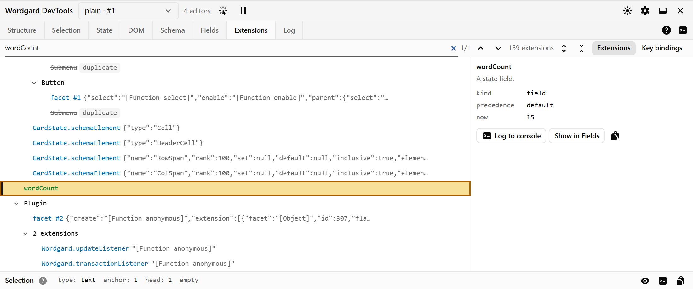

# Wordgard DevTools

A DevTools panel for Wordgard editors. Use it to inspect the
document, the state, the rendered DOM, the schema and the state fields, and to record transactions
with their timing.

It runs in two ways:

- **as a browser extension**: a "Wordgard" tab in Chrome or Firefox DevTools;
- **in the page**: a panel docked at the bottom of your app, for browsers without the extension
  or for a deployed demo.

[Try the demo](https://stesura.github.io/wordgard-devtools/): editors with the panel docked.

Inspired by [prosemirror-dev-tools](https://github.com/d4rkr00t/prosemirror-dev-tools), rebuilt
for Wordgard's model.

> Status: 0.x until Wordgard reaches 1.0, so minor versions may break things. Feedback is welcome:
> [open an issue](https://github.com/stesura/wordgard-devtools/issues). The extension isn't in the
> browser stores yet.

## Contents

- [Quick start](#quick-start)
- [Features](#features)
- [Usage](#usage)
  - [1. Register your editors](#1-register-your-editors)
  - [2. Mount the panel](#2-mount-the-panel)
  - [Keep it out of production](#keep-it-out-of-production)
- [Tabs](#tabs)
  - [Structure](#structure)
  - [Selection](#selection)
  - [State](#state)
  - [DOM](#dom)
  - [Schema](#schema)
  - [Fields](#fields)
  - [Extensions](#extensions)
  - [Log](#log)
- [Packages](#packages)
- [Development](#development)
- [License](#license)

## Quick start

```sh
npm install -D @stesura/wordgard-dev-tools @stesura/wordgard-dev-tools-panel
```

Add the plugin to your editor and dock the panel:

```ts
import { Wordgard } from "wordgard/editor";
import { basicSchema } from "wordgard/schema";
import { wordgardDevtools } from "@stesura/wordgard-dev-tools";
import { mountDevtools } from "@stesura/wordgard-dev-tools-panel";

Wordgard.create({ parent, doc, config: [basicSchema(), wordgardDevtools()] });
mountDevtools();
```

Run your dev server: the panel is docked at the bottom of the page. Both calls do nothing in
production builds (see [Keep it out of production](#keep-it-out-of-production)).

## Features

- **Editor picker**: every connected editor on the page, iframes included.
- **Element picker**: click a node in the page to find it in the panel. Picking doesn't move the caret.
- **Tabs**: Structure, Selection, State, DOM, Schema, Fields, Extensions and Log, described [below](#tabs). The ?
  in the tab bar shows the same guide in the panel, with links to Wordgard's reference.
- **Log the editor**: the button at the right of the tab bar logs the `Wordgard` instance to the
  console.

Nothing runs until the panel opens, and nothing is recorded until you press record.

## Usage

### 1. Register your editors

Editors register explicitly with the `wordgardDevtools()` plugin from `@stesura/wordgard-dev-tools`:

```ts
import { Wordgard } from "wordgard/editor";
import { wordgardDevtools } from "@stesura/wordgard-dev-tools";

Wordgard.create({
  parent,
  doc,
  config: [basicSchema(), wordCount, wordgardDevtools({ name: "main", fields: { wordCount } })],
});
```

| Option    | Type                                                       | Default                                        | Description                                                                                  |
| --------- | ---------------------------------------------------------- | ---------------------------------------------- | -------------------------------------------------------------------------------------------- |
| `name`    | `string`                                                   | the editor's `aria-label`, then `editor #n`    | Shown in the panel's editor picker.                                                          |
| `fields`  | `{[name: string]: GardState.Field}`                        | none: fields show as `field #n`                | Names the editor's state fields in the Fields tab.                                           |
| `names`   | `{[name: string]: facet, compartment, field or extension}` | none: as Wordgard names them, or numbered      | Names them in the Extensions tab, by identity (a field in the Fields tab too).               |
| `enabled` | `boolean`                                                  | `false` in production builds, `true` otherwise | Whether to register the editor. See [Keep it out of production](#keep-it-out-of-production). |

With react-wordgard, add the plugin to the `config` you pass to `<WordgardEditor>`.

`wordgard` (`>=0.6.2 <1`) is a peer dependency.
If a newer Wordgard breaks the devtools, they turn themselves off
with one console warning; your editor keeps working.
Below 0.6.2, npm refuses the install: upgrade Wordgard, or use an older devtools release.
On release of v1 of Wordgard, the devtools will need a release to support it.

### 2. Mount the panel

```ts
import { mountDevtools } from "@stesura/wordgard-dev-tools-panel";

mountDevtools();
```

The panel docks at the bottom of the page.

| Option      | Type        | Default                                        | Description                                                                              |
| ----------- | ----------- | ---------------------------------------------- | ---------------------------------------------------------------------------------------- |
| `parent`    | `Element`   | `document.body`                                | The element the panel goes in. Keep it outside your editors.                             |
| `enabled`   | `boolean`   | `false` in production builds, `true` otherwise | Whether to mount the panel. See [Keep it out of production](#keep-it-out-of-production). |
| `transport` | `Transport` | the in-page transport                          | How the panel talks to the page. Only for custom hosts.                                  |

It returns a handle:

| Field     | Type            | Description                                                              |
| --------- | --------------- | ------------------------------------------------------------------------ |
| `unmount` | `() => void`    | Removes the panel, for example on a route change in a single-page app.   |
| `ready`   | `Promise<void>` | Resolves once the panel has rendered.                                    |
| `host`    | `HTMLElement`   | The `<wordgard-devtools>` element; the panel renders in its shadow root. |

The panel renders in a shadow root, so its styles and your page's styles don't affect each other.
Its React UI is bundled with it and loaded lazily on the first `mountDevtools()` call. Your page
doesn't need React.

With React, there is no component to render: the panel brings its own React, so call
`mountDevtools()` in your entry file. To show it only while a component is mounted, for example
on one route:

```tsx
const WordgardDevtools = () => {
  useEffect(() => mountDevtools().unmount, []);
  return null;
};
```

### Keep it out of production

Both are off in production builds (when your bundler sets `process.env.NODE_ENV` to
`"production"`, as Vite, webpack and Next do):

- `wordgardDevtools()` adds nothing to the editor's config, so the editor isn't registered and
  no panel sees it.
- `mountDevtools()` mounts nothing and downloads nothing. The panel's chunks are still emitted but
  never loaded.

Pass `enabled` to either one to decide yourself:

```ts
wordgardDevtools({ enabled: true }); // keep it in production, e.g. on a staging build
mountDevtools({ enabled: settings.debug }); // your own switch
```

Without a bundler (plain ES modules, import maps) or with one that doesn't set `NODE_ENV` (Rollup
without `@rollup/plugin-replace`), every build counts as development: pass `enabled` there.

Their small page-side code still ships. To drop it as well, gate the calls so your bundler removes
them:

```ts
if (import.meta.env.DEV) {
  const { mountDevtools } = await import("@stesura/wordgard-dev-tools-panel");
  mountDevtools();
}

const config = [basicSchema(), ...(import.meta.env.DEV ? [wordgardDevtools()] : [])];
```

<!-- tabs:start: written from packages/panel/src/guides/ by `npm run readme`; edit there -->

## Tabs

### Structure


The document as represented by a tree of nested boxes, each box being a [plots](https://wordgard.net/docs/ref/#doc.Plot) or a [leaf](https://wordgard.net/docs/ref/#doc.Leaf) node.

- Each node displays its [type](https://wordgard.net/docs/ref/#doc.Node.Type), [marks](https://wordgard.net/docs/ref/#doc.Mark) and from–to positions.
- Selection is show through a darker (lighter in dark mode) background.
- [A document is a tree of nodes](https://wordgard.net/docs/ref/#h-document): [plots](https://wordgard.net/docs/ref/#doc.Plot) (nodes with content nodes) or [leaves](https://wordgard.net/docs/ref/#doc.Leaf); [marks](https://wordgard.net/docs/ref/#doc.Mark) are pieces of information attached to nodes.

Tips:

- Click a box for its detail and JSON in the Node pane; Escape clears it. Close the pane with its ×; the Node button, or a double-click on a box, opens it again (a double-click also scrolls the editor to the node).
- Right-click a box for more actions.
- Use the pick button, then click in the page, to find a node.
- In the page's console, `$wg` is the editor the panel shows.
- Decorations shows the editor's [decorations](https://wordgard.net/docs/ref/#editor.Decoration): ◆ marks a widget, ◇ 2 a node with two decorations, and a dotted underline the part of a text a range decorates. Click a box for what each adds.
- Decorations opens a pane beside the node's: the selected node's decorations (else the document's), the count, which lists every decoration by source (pick one to go to its node), and arrows that step through the nodes that have any. Close it, or press Escape in it, to turn decorations off.
- By default a range decoration applies to the text in its range, not the paragraph around it; a point decoration to the node starting at it.

### Selection


The [selection](https://wordgard.net/docs/ref/#state.GardSelection), its [slice](https://wordgard.net/docs/ref/#doc.Slice), and its anchor and head [resolved](https://wordgard.net/docs/ref/#h-resolved-positions). Each card's guide explains its fields.

Tips:

- The bar at the bottom of the panel always shows the selection, whichever tab is open: its type, anchor, head and marks.
- Nodes link to the Structure, types to the Schema.
- Right click a card to log or copy it.

### State


The [editor state](https://wordgard.net/docs/ref/#state.GardState) as collapsible JSON: [`GardState.toJSON()`](https://wordgard.net/docs/ref/#state.GardState.toJSON), with the named fields that serialise.

- The state tracks the current document, the selection, the configuration of the editor, and any extra state defined by extensions, in [fields](https://wordgard.net/docs/ref/#state.GardState.Field).

Tips:

- Right-click a line to highlight its node in the editor, show it in the Structure, log it (live or as JSON), or copy its JSON or path.
- The toolbar logs the whole state, live or as JSON.
- Download the state as a JSON file, or replace it from one: the file is checked against the schema first, and the replacement can be undone. Fields aren't restored.

### DOM


The editor's [content DOM](https://wordgard.net/docs/ref/#editor.Wordgard.contentDOM): the editable DOM element holding the editor content. Each element shows the document node it draws; text shows its position.

- Elements that draw no node (widgets, decorations) are marked as chrome.
- Whether the editor is connected, editable, focused or composing: the bottom bar's Editor.

Tips:

- Click an element to outline it in the page; Escape clears it.
- Right-click an element to show its node in the Structure, log it, or log or copy its outer HTML.

### Schema


The [schema](https://wordgard.net/docs/ref/#h-schema)'s node and mark types and node groups: what each holds, where it can go, its parameter and its spec.

- A schema is a collection of node and mark types, including exactly one document type, plus an optional set of [overrides](https://wordgard.net/docs/ref/#doc.Schema.Override) that modify the relations between those elements.

Tips:

- Filter by name or tag. Collapse a section from its title.
- Type names link between cards. Double-click a card to see its spec as JSON.
- Order marks by rank to see how they nest.
- Each section's guide explains its cards.
- `decorated`: the editor draws the type differently, through [tag decorations](https://wordgard.net/docs/ref/#editor.Decoration.Tag) (a shape, wrappers, widgets, attributes) or [`Decoration.Mark.shape`](https://wordgard.net/docs/ref/#editor.Decoration.Mark.shape); the Effective view lists them. Functions of the node are evaluated on the first node of the type in the document.

### Fields


Each [`GardState.Field`](https://wordgard.net/docs/ref/#state.GardState.Field): its value, and the changes seen to it, each linked to its transaction in the Log.

- Fields store additional information in an editor state, and keep it in sync with the rest of the state.
- Changes are tracked while this tab is shown, or while the Log records.

Tips:

- Name unnamed fields ("field #n") with `wordgardDevtools({fields: {name: field}})`.
- Search filters the fields by name or by value, the whole value, not just its preview.
- Expand a change to see its value; right-click to log or copy it.
- For a [`PointSet` or `RangeSet`](https://wordgard.net/docs/ref/#set), click a position to show its node in the Structure.
- Amber "kept, not mapped": the set wasn't mapped through a change that moved it; usually a missing `set.map(tr.changes)`.
- Expand a set change to see what it added and dropped.

### Extensions



The editor's [configuration](https://wordgard.net/docs/ref/#state.GardState.Extension) as Wordgard resolves it: what it keeps, at which [precedence](https://wordgard.net/docs/ref/#state.GardState.prec), and in which order each [facet](https://wordgard.net/docs/ref/#state.GardState.Facet) gets its values.

- Extensions: the configuration, nested as the app wrote it.
- Details: the selected extension, its value in the current state, and its place among its facet's values.
- Key bindings: the editor's [key bindings](https://wordgard.net/docs/ref/#editor.KeyBinding), in the order Wordgard tries them.

Tips:

- Click a row to select it; double-click it, or click the + button, to open its details.
- Click the keyboard button to open the key bindings.
- Click "By facet" to list each facet with its values in the order Wordgard gives them.
- Name what shows as `facet #n` or `compartment #n` with `wordgardDevtools({names: {name: value}})`, or a plain `{name: "spellcheck", extension}` object.
- Right-click a row, the details or a key binding (or Shift+F10) to log it to the console, show it in Fields or copy it.

### Log


Recorded [transactions](https://wordgard.net/docs/ref/#state.Transaction). For each: what it changed, its selection, [effects](https://wordgard.net/docs/ref/#state.Transaction.Effect) and [annotations](https://wordgard.net/docs/ref/#state.Transaction.Annotation), and how long its [dispatch](https://wordgard.net/docs/ref/#editor.Wordgard.dispatch) and [flush](https://wordgard.net/docs/ref/#editor.Wordgard.flush) took.

- Typically, a user action creates a single transaction, which may contain any number of document changes, may change the selection, or have other effects.
- [userEvent](https://wordgard.net/docs/ref/#state.Transaction.userEvent): a string identifying the user interface event, dot-separated (`input.type`, `select.pointer`).
- Updates over 16 ms, a frame, are flagged.

Tips:

- Press Record, then use the editor.
- Filter by user event, what changed or annotation; sort by any column.
- Right-click a row to log the transaction or copy it as JSON or text; right-click a part of its detail to log or copy that part.
- Copy as repro copies a Node script that replays the transactions on plain Wordgard, from the state before the oldest, and checks the document it ends with: a bug report's schema, document and steps. Its header says what it leaves out.
- Untick record select.pointer to leave out selections made with the pointer, and record focus to leave out focus changes.
- In the page's console, `$tr` is the transaction shown here, `$wg` its editor.

<!-- tabs:end -->

## Packages

| Package                                               | What it is                                                                                                                                                                   |
| ----------------------------------------------------- | ---------------------------------------------------------------------------------------------------------------------------------------------------------------------------- |
| [`@stesura/wordgard-dev-tools`](packages/devtools)    | Page side, framework-free. The plugin, the editor registry and the agent that answers the panel.                                                                             |
| [`@stesura/wordgard-dev-tools-panel`](packages/panel) | The React panel and `mountDevtools()`. It uses a `Transport`, so it doesn't depend on where it runs. React is bundled, so pages need neither React nor a particular version. |
| [`packages/extension`](packages/extension)            | The WXT extension shell around the panel.                                                                                                                                    |
| [`demo`](demo)                                        | A Vite page with several editors and the in-page panel docked.                                                                                                               |

## Development

This repository expects `wordgard` and
[`react-wordgard`](https://github.com/stesura/react-wordgard) to be checked out next to it. They are
local path dependencies.

```sh
(cd ../wordgard && npm install --no-package-lock)   # builds its dist/
npm install
npx playwright install chromium                      # once, for the tests

npm run dev          # the demo, with the panel docked
npm run typecheck
npm test             # Vitest in Chromium
npm run build        # packages, extension (Chrome and Firefox) and demo
npm run e2e -w wordgard-devtools-extension   # the extension's panel against the demo
```

To try the browser extension, load it unpacked from `packages/extension/.output/chrome-mv3`
(Chrome) or `firefox-mv3` (Firefox) after `npm run build`, then open the **Wordgard** tab in
DevTools.

Node 22.12 or later. The design and its progress are in
[docs/partially-executed/plan.md](docs/partially-executed/plan.md).

See [CONTRIBUTING.md](CONTRIBUTING.md) to contribute, and [SECURITY.md](SECURITY.md) to report a
vulnerability.

## License

[MIT](LICENSE). The panel package and the extension bundle third-party code; their builds include
its licences in `THIRD_PARTY_LICENSES.txt`. The components in
[packages/panel/src/components/ui](packages/panel/src/components/ui) are copied from shadcn/ui
([MIT](packages/panel/src/components/ui/LICENSE.md)). The tabs' guides adapt wording from
Wordgard's reference documentation (MIT, Marijn Haverbeke).
