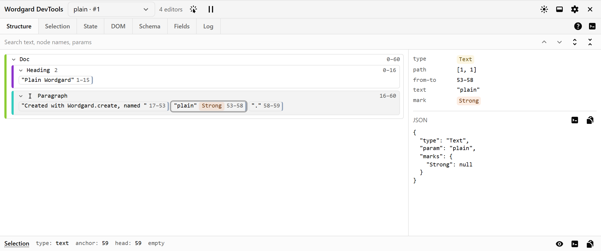
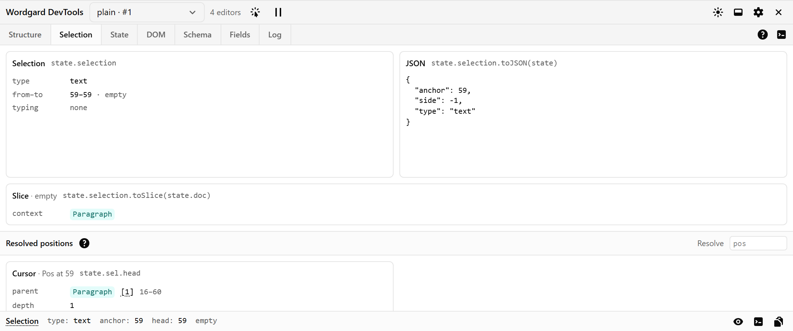
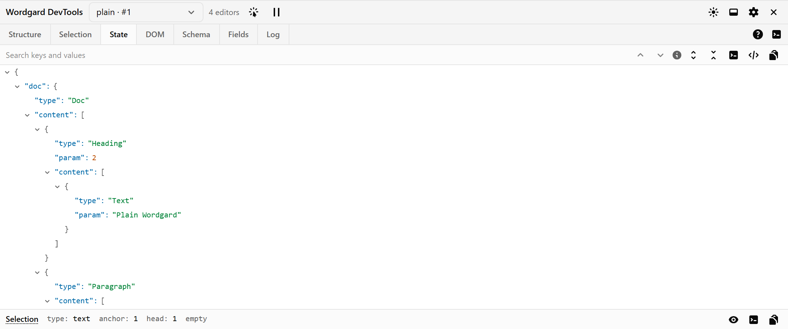
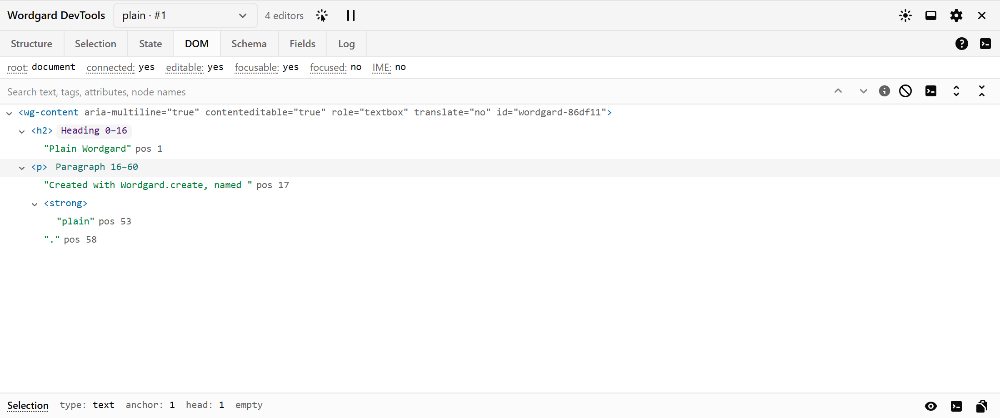
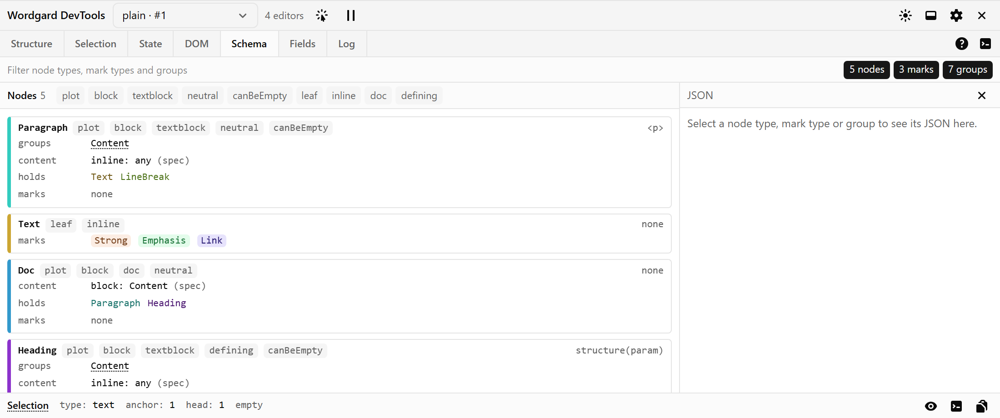
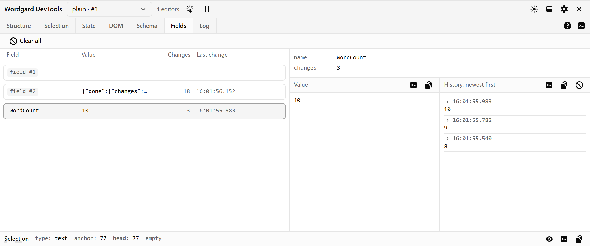
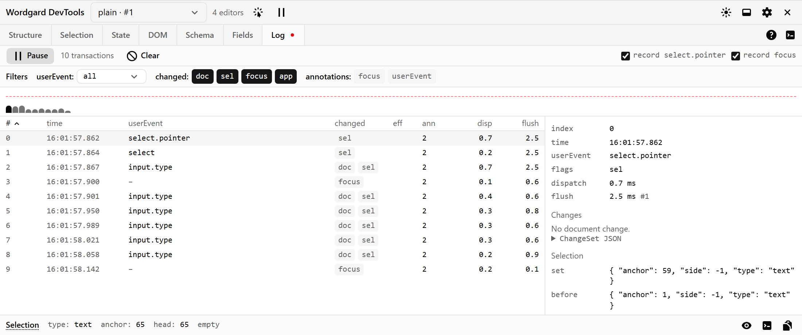

# Wordgard DevTools

A DevTools panel for Wordgard editors. Use it to inspect the
document, the state, the rendered DOM, the schema and the state fields, and to record transactions
with their timing.

It runs in two ways:

- **as a browser extension**: a "Wordgard" tab in Chrome or Firefox DevTools;
- **in the page**: a panel docked at the bottom of your app, for browsers without the extension
  or for a deployed demo.

> Status: work in progress, not yet published to npm or the extension stores.

## Contents

- [Quick start](#quick-start)
- [Features](#features)
- [Inspiration](#inspiration)
- [Usage](#usage)
  - [1. Register your editors](#1-register-your-editors)
  - [2. Mount the panel](#2-mount-the-panel)
  - [Keep it out of production](#keep-it-out-of-production)
- [Packages](#packages)
- [Development](#development)
- [License](#license)

## Quick start

```sh
npm install -D @stesura/wordgard-dev-tools @stesura/wordgard-dev-tools-panel
```

Add the plugin to your editor and dock the panel:

```ts
import {Wordgard} from "wordgard/editor"
import {basicSchema} from "wordgard/schema"
import {wordgardDevtools} from "@stesura/wordgard-dev-tools"
import {mountDevtools} from "@stesura/wordgard-dev-tools-panel"

Wordgard.create({parent, doc, config: [basicSchema(), wordgardDevtools()]})
mountDevtools()
```

Run your dev server: the panel is docked at the bottom of the page. Both calls do nothing in
production builds (see [Keep it out of production](#keep-it-out-of-production)).

## Features

- **Editor picker**: every connected editor on the page, iframes included.
- **Element picker**: click a node in the page to find it in the panel. Picking doesn't move the caret.
- **Tabs**: Structure, Selection, State, DOM, Schema, Fields and Log, described [below](#tabs). The ?
  in the tab bar shows the same guide in the panel, with links to Wordgard's reference.
- **Log the editor**: the button at the right of the tab bar logs the `Wordgard` instance to the
  console.

Nothing runs until the panel opens, and nothing is recorded until you press record.

<!-- tabs:start: written from packages/panel/src/guides.ts by `npm run readme`; edit there -->

## Tabs

### Structure



The document as nested boxes: each node with its type, marks and from–to positions. The selection is marked. [A document is a tree of nodes](https://wordgard.net/docs/ref/#h-document): [plots](https://wordgard.net/docs/ref/#doc.Plot) (nodes with content nodes) or [leaves](https://wordgard.net/docs/ref/#doc.Leaf); [marks](https://wordgard.net/docs/ref/#doc.Mark) are pieces of information attached to nodes.

- from–to: [positions are offset numbers](https://wordgard.net/docs/ref/#h-resolved-positions) into the document.
- Hover a box to outline its node in the page; click it for its detail, parameters and JSON.
- Right-click a box to scroll it into view, show its type in Schema or its element in DOM, log it, or copy its JSON or path.
- Press the pick button in the header, then click in the page, to find a node here.

### Selection



The [selection](https://wordgard.net/docs/ref/#state.GardSelection), its [slice](https://wordgard.net/docs/ref/#doc.Slice), and its anchor and head [resolved](https://wordgard.net/docs/ref/#h-resolved-positions).

- The bar at the bottom of the panel always shows the selection, whichever tab is open: its type, anchor, head and marks.
- Nodes link to the Structure, types to the Schema.
- Hover a card to log or copy it.

### State



The [editor state](https://wordgard.net/docs/ref/#state.GardState) as collapsible JSON: [`GardState.toJSON()`](https://wordgard.net/docs/ref/#state.GardState.toJSON), with the named fields that serialise. The state tracks the current document, the selection, the configuration of the editor, and any extra state defined by extensions.

- Right-click a line to highlight its node in the editor, show it in the Structure, log it (live or as JSON), or copy its JSON or path.
- The toolbar logs the whole state, live or as JSON.
- Download the state as a JSON file, or replace it from one: the file is checked against the schema first, and the replacement can be undone. Fields aren't restored.
- Name your [fields](https://wordgard.net/docs/ref/#state.GardState.Field) with `wordgardDevtools({fields: {name: field}})` to see them here.

### DOM



The editor's [content DOM](https://wordgard.net/docs/ref/#editor.Wordgard.contentDOM): the editable DOM element holding the editor content. Each element shows the document node it draws; text shows its position.

- Click an element to outline it in the page. Right-click it to show its node in the Structure, log it, or log or copy its outer HTML.
- Elements that draw no node (widgets, decorations) are marked as chrome.
- The status line says whether the editor is connected, editable, focused or composing; hover a label for more.

### Schema



The [schema](https://wordgard.net/docs/ref/#h-schema)'s node and mark types and node groups: what each holds, where it can go, its parameter and its spec. A schema is a collection of node and mark types, including exactly one document type, plus an optional set of overrides that modify the relations between those elements.

- Filter by name or tag. Collapse a section from its title.
- Type names link between cards. Double-click a card to see its spec as JSON.
- Order marks by rank to see how they nest.

### Fields



Each [`GardState.Field`](https://wordgard.net/docs/ref/#state.GardState.Field): fields store additional information in an editor state, and keep it in sync with the rest of the state. Its value, and the changes seen to it, each linked to its transaction in the Log.

- Changes are tracked while this tab is shown, or while the Log records.
- Unnamed fields show as "field #n": name them with `wordgardDevtools({fields: {name: field}})`.
- Expand a change to see the value it set; right-click it to log or copy it.

### Log



Recorded [transactions](https://wordgard.net/docs/ref/#state.Transaction). Typically, a user action creates a single transaction, which may contain any number of document changes, may change the selection, or have other effects. For each: what it changed, its selection, [effects](https://wordgard.net/docs/ref/#state.Transaction.Effect) and [annotations](https://wordgard.net/docs/ref/#state.Transaction.Annotation), and how long its [dispatch](https://wordgard.net/docs/ref/#editor.Wordgard.dispatch) and [flush](https://wordgard.net/docs/ref/#editor.Wordgard.flush) took.

- Press Record, then use the editor. Updates over 16 ms are flagged.
- [userEvent](https://wordgard.net/docs/ref/#state.Transaction.userEvent): a string identifying the user interface event, dot-separated (`input.type`, `select.pointer`).
- changed: `doc`, `sel`; `focus`, the editor's [focused status changed](https://wordgard.net/docs/ref/#editor.Wordgard.isFocusChange); `app`, [created by a transaction appender](https://wordgard.net/docs/ref/#state.Transaction.appended).
- Filter by user event, what changed or annotation; sort by any timing column.
- Right-click a row to log the transaction or copy it as JSON or text; right-click a part of its detail to log or copy that part.
- Untick record select.pointer to leave out selections made with the pointer, and record focus to leave out focus changes.

<!-- tabs:end -->

## Inspiration

Inspired by [prosemirror-dev-tools](https://github.com/d4rkr00t/prosemirror-dev-tools), rebuilt for
Wordgard's model. Changes to make it easier to use:

- **Multiple editors**: one panel for every editor on the page, iframes included, with a picker.
- **Element selector**: pick a node in the page to reveal it in the panel.
- **Highlighting**: hovering or selecting a node outlines it in the page.
- **Positions**: every node shows its from/to positions, and text in the DOM shows where it sits.
- **Dock position**: dock the in-page panel at any side, with resizable panes.
- **Pause**: stops the panel from reading the editor, so it doesn't affect performance.
- **Low overhead**: nothing is injected until the panel opens, and nothing is recorded until you
  press record.
- **Timing**: each update is timed, and slow ones (over 16 ms) are flagged in the log.
- **Fields**: plugin state with its history of changes, linked to the transaction log.
- **DOM**: the content DOM, with the node each element draws.
- **Filters and links**: search and filters in the tabs, links between them (a field change opens
  its transaction).
- **Isolation**: the in-page panel renders in a shadow root, so its styles and the page's don't
  affect each other.
- **Extension**: runs as a browser DevTools tab, or docked in the page.
- **Light and dark mode**: follows the system or the DevTools theme, with a manual toggle.

## Usage

### 1. Register your editors

Editors register explicitly with the `wordgardDevtools()` plugin from `@stesura/wordgard-dev-tools`:

```ts
import {Wordgard} from "wordgard/editor"
import {wordgardDevtools} from "@stesura/wordgard-dev-tools"

Wordgard.create({
  parent,
  doc,
  config: [
    basicSchema(),
    wordCount,
    wordgardDevtools({name: "main", fields: {wordCount}}),
  ],
})
```

| Option | Type | Default | Description |
| --- | --- | --- | --- |
| `name` | `string` | the editor's `aria-label`, then `editor #n` | Shown in the panel's editor picker. |
| `fields` | `{[name: string]: GardState.Field}` | none: fields show as `field #n` | Names the editor's state fields in the Fields tab. |
| `enabled` | `boolean` | `false` in production builds, `true` otherwise | Whether to register the editor. See [Keep it out of production](#keep-it-out-of-production). |

With react-wordgard, add the plugin to the `config` you pass to `<WordgardEditor>`.

`wordgard` (`>=0.6.2 <1`) is a peer dependency.
If a newer Wordgard breaks the devtools, they turn themselves off
with one console warning; your editor keeps working.
Below 0.6.2, npm refuses the install: upgrade Wordgard, or use an older devtools release.
On release of v1 of Wordgard, the devtools will need a release to support it.

### 2. Mount the panel

```ts
import {mountDevtools} from "@stesura/wordgard-dev-tools-panel"

mountDevtools()
```

The panel docks at the bottom of the page.

| Option | Type | Default | Description |
| --- | --- | --- | --- |
| `parent` | `Element` | `document.body` | The element the panel goes in. Keep it outside your editors. |
| `enabled` | `boolean` | `false` in production builds, `true` otherwise | Whether to mount the panel. See [Keep it out of production](#keep-it-out-of-production). |
| `transport` | `Transport` | the in-page transport | How the panel talks to the page. Only for custom hosts. |

It returns a handle:

| Field | Type | Description |
| --- | --- | --- |
| `unmount` | `() => void` | Removes the panel, for example on a route change in a single-page app. |
| `ready` | `Promise<void>` | Resolves once the panel has rendered. |
| `host` | `HTMLElement` | The `<wordgard-devtools>` element; the panel renders in its shadow root. |

The panel renders in a shadow root, so its styles and your page's styles don't affect each other.
Its React UI is bundled with it and loaded lazily on the first `mountDevtools()` call. Your page
doesn't need React.

With React, there is no component to render: the panel brings its own React, so call
`mountDevtools()` in your entry file. To show it only while a component is mounted, for example
on one route:

```tsx
const WordgardDevtools = () => {
  useEffect(() => mountDevtools().unmount, [])
  return null
}
```

### Keep it out of production

Both are off in production builds (when your bundler sets `process.env.NODE_ENV` to
`"production"`, as Vite, webpack and Next do):

- `wordgardDevtools()` adds nothing to the editor's config, so the editor isn't registered and
  no panel sees it.
- `mountDevtools()` mounts nothing and downloads nothing. The panel's chunks are still emitted but
  never loaded.

Pass `enabled` to either one to decide yourself:

```ts
wordgardDevtools({enabled: true}) // keep it in production, e.g. on a staging build
mountDevtools({enabled: settings.debug}) // your own switch
```

Without a bundler (plain ES modules, import maps) or with one that doesn't set `NODE_ENV` (Rollup
without `@rollup/plugin-replace`), every build counts as development: pass `enabled` there.

Their small page-side code still ships. To drop it as well, gate the calls so your bundler removes
them:

```ts
if (import.meta.env.DEV) {
  const {mountDevtools} = await import("@stesura/wordgard-dev-tools-panel")
  mountDevtools()
}

const config = [basicSchema(), ...(import.meta.env.DEV ? [wordgardDevtools()] : [])]
```

## Packages

| Package | What it is |
| --- | --- |
| [`@stesura/wordgard-dev-tools`](packages/devtools) | Page side, framework-free. The plugin, the editor registry and the agent that answers the panel. |
| [`@stesura/wordgard-dev-tools-panel`](packages/panel) | The React panel and `mountDevtools()`. It uses a `Transport`, so it doesn't depend on where it runs. React is bundled, so pages need neither React nor a particular version. |
| [`packages/extension`](packages/extension) | The WXT extension shell around the panel. |
| [`demo`](demo) | A Vite page with several editors and the in-page panel docked. |

## Development

This repository expects `wordgard` and
[`react-wordgard`](https://github.com/stesura/react-wordgard) to be checked out next to it. They are
local path dependencies.

```sh
(cd ../wordgard && npm install --no-package-lock)   # builds its dist/
npm install
npx playwright install chromium                      # once, for the tests

npm run dev          # the demo, with the panel docked
npm run typecheck
npm test             # Vitest in Chromium
npm run build        # packages, extension (Chrome and Firefox) and demo
npm run e2e -w wordgard-devtools-extension   # the extension's panel against the demo
```

To try the browser extension, load it unpacked from `packages/extension/.output/chrome-mv3`
(Chrome) or `firefox-mv3` (Firefox) after `npm run build`, then open the **Wordgard** tab in
DevTools.

Node 22.12 or later. The design and its progress are in
[docs/partially-executed/plan.md](docs/partially-executed/plan.md).

See [CONTRIBUTING.md](CONTRIBUTING.md) to contribute, and [SECURITY.md](SECURITY.md) to report a
vulnerability.

## License

[MIT](LICENSE). The panel package and the extension bundle third-party code; their builds include
its licences in `THIRD_PARTY_LICENSES.txt`. The components in
[packages/panel/src/components/ui](packages/panel/src/components/ui) are copied from shadcn/ui
([MIT](packages/panel/src/components/ui/LICENSE.md)).
